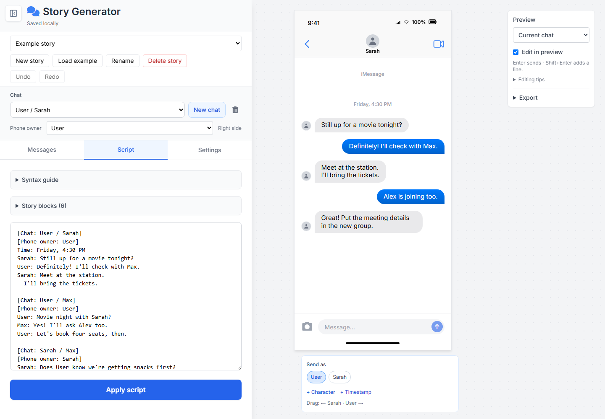
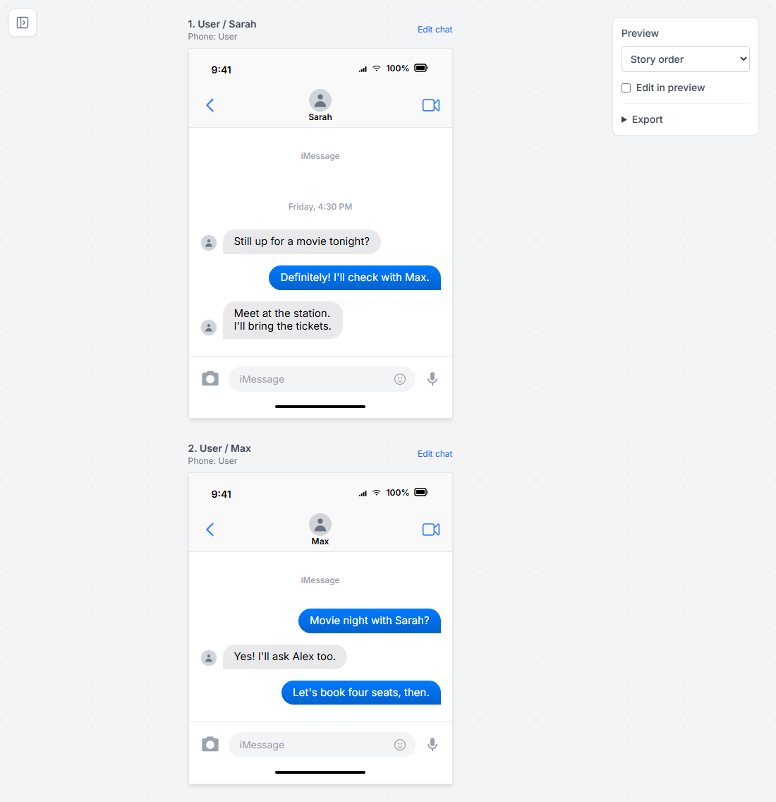
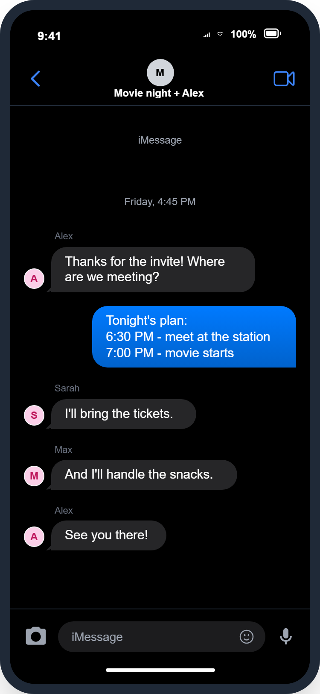

# Chat Story Generator

[Open the app](https://nastinax.github.io/chat/)

Create fictional, iMessage-style conversations with a live preview. Write a script, edit messages directly in the phone preview, and export a single image or an ordered set of screenshots.

The app runs in your browser from a single HTML file. No build step or account is required.




## Get started

1. Download or clone this repository.
2. Open **[index.html](index.html)** in a modern browser.
3. Click **Load example** to explore a movie-night story with private chats, group chats, timestamps, and images.
4. Edit the story using **Messages**, **Script**, or the preview itself.

An internet connection is needed to load the styles, icons, fonts, and image export library from CDNs.

You can also serve the folder locally if Python is installed:

```sh
python -m http.server 8000
```

Then open [localhost:8000](http://localhost:8000). Keep using the same address to return to your saved stories; browser storage is tied to the page's location.

## Choose how to edit

| Mode | How it works |
| --- | --- |
| **Messages** | Add text, images, or timestamps with a form. Search, filter, reorder, or use the eye icon to locate a message in the preview. |
| **Script** | Write conversations as text, then click **Apply script** to update the chats. |
| **Edit in preview** | Type into the phone's input and choose a sender below it. Enabled by default; turn it off in the Preview controls when you want a clean preview. |

When editing in the preview:

- **Enter** adds a message; **Shift+Enter** adds a new line.
- **Double-click** a message to edit it.
- Drag its handle **up or down** to reorder it, or **left or right** to change its sender. Drop it on a character button to choose that sender.
- **Right-click** or click **⋯** for editing, duplication, insertion, sender, and deletion options.
- Use **+ Character**, **+ Timestamp**, or the camera icon to add more content.
- The subtle **down arrow** jumps to the visible chat's input in longer conversations.

Preview edits also update the script. Apply any pending script edits before continuing to edit in the preview.

The small sidebar button at the top-left collapses the editor. Click it again, or press **Esc**, to reopen it.

## Write a script

Start a conversation with `[Chat: Name / Name]`, then prefix each message with its sender's name. List three or more people for a group chat.

```text
[Chat: User / Sarah]
[Phone owner: User]
Time: Friday, 4:30 PM
Sarah: Still up for a movie tonight?
User: Definitely! I'll check with Max.
Sarah: Meet at the station.
  I'll bring the tickets.

[Chat: User / Max]
[Phone owner: User]
User: Movie night with Sarah?
Max: Yes! Let's get snacks first.

[Chat: Sarah / Max]
[Phone owner: Sarah]
Sarah: Does User know about the snacks?
Max: I'll suggest it in the group.

[Chat: User / Sarah / Max]
[Phone owner: User]
Max: Snacks before the movie?
Sarah: Only if there's popcorn!
User: I found the perfect place.
User: [img:A cinema entrance with a café next door]

[Chat: User / Sarah]
[Phone owner: User]
User: See you at 6:30!
Sarah: See you there!
```

**Phone owner** determines whose messages appear on the right. Other participants appear on the left; group chats identify their senders. The owner must be a participant and must stay the same across repeated blocks of that chat.

Repeat a chat header to return to that conversation later in the story. Chats are matched by their participants, regardless of their order in the header. Adding another participant creates a different chat, so `[Chat: User / Sarah / Max / Alex]` can follow the three-person group.

New names create shared characters automatically. A character's name and avatar are reused wherever that character appears in the story.

### Timestamps, images, and multiline messages

| Syntax | Result |
| --- | --- |
| `Sarah: Hello!` | A text message from Sarah. |
| `Time: Friday, 4:30 PM` | A centered timestamp with no sender. |
| `Sarah: [img:A beach at sunset]` | An image placeholder showing the description. |
| A continuation indented by two spaces | A new line within the preceding message. |

For an actual image, upload a file through **Messages** or the preview's camera button. You can also use an image URL, with optional alt text:

```text
Sarah: [img:https://example.com/photo.jpg|alt:A beach at sunset]
```

Replace the example URL with your image's address. Descriptions create placeholders; they do not generate photos. Uploaded images are preserved in JSON backups, while external image URLs still depend on their source.

Quote names containing characters such as `/`, brackets, or colons:

```text
[Chat: User / "Sarah / Work"]
[Phone owner: User]
"Sarah / Work": Hello!
```

To write literal text that starts with image syntax, put a backslash before it: `Sarah: \[img:This is text]`.

**Applying a script replaces messages in the chats it lists.** Other chats remain in the story. A script without chat headers updates the currently selected chat. Syntax errors are shown beside the editor without applying the changes.

## Preview chats in story order

Choose **Story order** in the Preview controls to stack chat blocks in the order they appear in the script. A later visit to the same chat appears as its own block. **Current chat** shows that conversation's messages together.

Open **Story blocks** in the Script tab to move or duplicate a whole block. In story view, each block has its own input, so preview edits go into that part of the story.




## Customize the appearance

In **Settings**, adjust the chat title, width, clock, battery, bubble color, avatars, phone frame, dark mode, and image cropping.

**Apply to all chats** is enabled by default and shares the appearance across the current story, including new chats. Turn it off to style chats individually. Turning it back on copies the current chat's appearance to the others. Chat titles and group avatars stay separate; character names and avatars remain shared.




## Export images

Open **Export** in the Preview controls; this section starts collapsed. Choose a resolution from **1×** to **3×**, then select an export:

| Export | What you get |
| --- | --- |
| **Export chat (ZIP)** in Current chat view | Screenshots covering the selected conversation. |
| **Export story (ZIP)** in Story order view | Screenshots of all story blocks, numbered in script order. |
| **Save chat (PNG)** | One screenshot of the selected chat at its current scroll position, including when Story order is selected. |

ZIP export uses one download for the full set of images. **Keep bubbles whole** avoids splitting messages across screenshots when they fit within one screen. Adjust **Screenshot overlap (px)** in Settings to control how much adjacent screenshots repeat.

Editing buttons, character controls, and unsent preview text are excluded from the images. Progress and **Cancel** remain visible if you collapse the Export section during a capture. Apply pending script edits before exporting a story.

## Save, import, and manage stories

- Use the story selector to switch stories. **New story**, **Rename**, and **Delete story** manage the saved stories; the trash button beside the chat selector deletes only that chat.
- Changes autosave in this browser using IndexedDB. Check the status below the app title.
- Use **Settings → Story backup (JSON) → Export** to save an editable copy of the current story, including its name, chats, characters, images, settings, order, and drafts.
- **Import** replaces the current story with the backup. Use **Undo** to restore the previous version, or create a new story before importing to keep both. Duplicate story names receive a number.
- The **Undo** and **Redo** buttons reverse editing changes. **Ctrl/Cmd+Z** and **Ctrl/Cmd+Shift+Z** work outside text fields; inside a text field, normal text undo applies.

Saved stories belong to this browser and page address. They do not automatically sync between browsers or devices. Export JSON backups before clearing browser data or moving the app to a different address. Each backup contains one story, not the entire story library.

## Project files

| File | Purpose |
| --- | --- |
| [`index.html`](index.html) | The complete app: interface, styles, script parser, browser storage, and exports. |
| [`docs/images/`](docs/images/) | Screenshots and an exported example used in this README. |

The app uses Tailwind CSS, Font Awesome, dom-to-image, and the Inter font through the external resources linked in `index.html`. No package installation or compilation is needed to run it. It can be served by a static web host.
